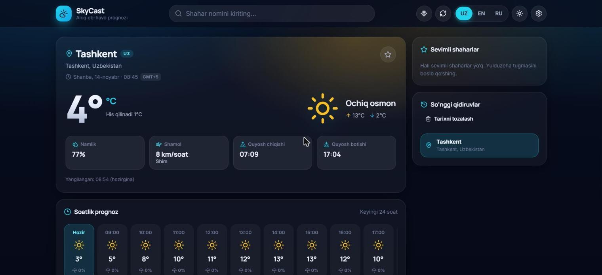
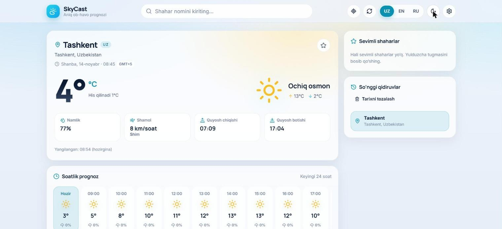
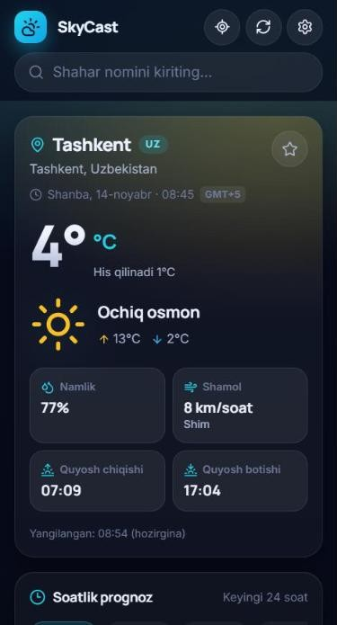

# SkyCast — Professional Weather Forecast Dashboard

🌐 **Live demo:** [skycastuz.netlify.app](https://skycastuz.netlify.app/)

SkyCast is a production-quality weather forecasting web application built with **React + Vite**.
It shows real-time conditions, a 24-hour forecast, a 7-day forecast, detailed metrics, interactive
charts and a map for any city in the world — powered entirely by free, key-less APIs.

> No API key required. All weather data comes from [Open-Meteo](https://open-meteo.com/).



## Features

- **Current weather** — temperature, feels-like, condition, min/max, humidity, wind speed & direction,
  pressure, visibility, UV index, cloud cover, sunrise/sunset, local time, last-updated time.
- **Hourly forecast** — next 24 hours with icons, temperature and precipitation probability
  (horizontally scrollable on mobile).
- **7-day forecast** — day/date, condition, max/min temperature range bar, precipitation probability, wind.
- **Weather details** — humidity, wind (with compass + gusts), pressure, UV index (with category), visibility,
  cloud cover, dew point.
- **Charts (Recharts)** — 24-hour temperature, 7-day max/min temperature, 24-hour precipitation probability;
  responsive, custom tooltips, correct units, gaps for missing values.
- **City search** — Open-Meteo Geocoding with debounce, request cancellation, keyboard navigation,
  loading / empty / error states; shows city, region and country so identically named cities are distinguishable.
- **My location** — browser Geolocation with explicit handling of *unsupported*, *denied*, *unavailable* and
  *timeout* states; reverse geocoding via OSM Nominatim (falls back to coordinates — never fakes a city name).
- **Favorites & recent searches** — persisted in LocalStorage, de-duplicated by coordinates.
- **Interactive map** — Leaflet + OpenStreetMap with a marker that follows the selected city (no fake radar layers).
- **Units** — °C/°F, km/h · m/s · mph, hPa/mmHg; mathematically exact conversions applied instantly everywhere.
- **Themes** — dark and light; every surface, input, chart and the map container adapt.
- **Internationalization** — Uzbek (default), English, Russian; all UI text and WMO weather descriptions.
- **Resilience** — validated API responses, typed errors (network / HTTP / malformed / invalid coordinates),
  retry button, request de-duplication + 5-minute cache, error boundaries, loading skeletons, toasts.
- **Dynamic accents** — background glow and hero card tint follow the current weather group.
- **Installable app (PWA)** — install button on Android / Windows / macOS / ChromeOS (native prompt),
  step-by-step “Add to Home Screen” guide on iPhone/iPad; full-screen standalone mode, app icons incl. maskable,
  offline app shell and an offline banner. Weather data is never served from cache as if it were current.
- **In-app location permission** — SkyCast explains why it needs location *before* the browser asks; if access was
  blocked it shows platform-specific steps (Android browser / installed app, iOS, desktop) and continues automatically
  as soon as access is re-enabled. Detects non-HTTPS pages, where browsers refuse geolocation.
- **Responsive** — verified from 320 px phones to 1920 px screens, portrait and landscape, dark and light themes.

## Technologies

| Area        | Stack                                                                 |
| ----------- | --------------------------------------------------------------------- |
| UI          | React 19, React Hooks, Context API, CSS3 (custom design tokens)       |
| Build       | Vite                                                                  |
| Icons       | [Lucide React](https://lucide.dev/)                                   |
| Charts      | [Recharts](https://recharts.org/)                                     |
| Map         | [Leaflet](https://leafletjs.com/) + [react-leaflet](https://react-leaflet.js.org/) |
| Weather     | [Open-Meteo Forecast API](https://open-meteo.com/en/docs)             |
| Geocoding   | [Open-Meteo Geocoding API](https://open-meteo.com/en/docs/geocoding-api) |
| Reverse geo | [OSM Nominatim](https://nominatim.org/release-docs/latest/api/Reverse/) |
| Tests       | Vitest + Testing Library + jsdom                                      |
| Lint        | oxlint (React + hooks rules)                                          |
| PWA         | [vite-plugin-pwa](https://vite-pwa-org.netlify.app/) (Workbox)        |

## Getting started

### Requirements

- Node.js 20+ (tested with Node 22)
- npm 10+

### Installation

```bash
git clone https://github.com/azizbekqodirov2005/weather-app.git
cd weather-app
npm install
```

### Development

```bash
npm run dev
```

Open the printed URL (by default <http://localhost:5173>).

### Production build

```bash
npm run build      # outputs to dist/
npm run preview    # serves the production build locally
```

### Tests and lint

```bash
npm test           # unit tests (utils, conversions, weather codes, API handling, i18n, storage hook)
npm run lint       # oxlint
```

## Installing on a phone (PWA)

Browsers only allow installation and geolocation on **HTTPS** pages (or `localhost`), so for a phone the app must be
deployed. With the included `netlify.toml`:

```bash
npm run build
npx netlify-cli login            # once
npx netlify-cli deploy --prod --dir=dist
```

Then open the https URL on the phone:

- **Android (Chrome / Edge / Samsung Internet):** tap **Install** in the SkyCast banner (or Settings → *Install app*).
- **iPhone / iPad (Safari):** Share → *Add to Home Screen* (SkyCast shows these steps itself).

## Project structure

```
src/
  components/
    CurrentWeather/   Hero card with current conditions
    HourlyForecast/   24-hour scrollable strip
    WeeklyForecast/   7-day list with temperature range bars
    WeatherDetails/   Metric cards (humidity, wind, pressure, UV, …)
    WeatherCharts/    Recharts charts
    WeatherMap/       Leaflet map
    FavoriteCities/   Favorites + recent searches sidebar
    SearchBar/        Debounced geocoding search (combobox)
    Settings/         Units / language / theme panel
    Header/ Footer/ Loading/ Error/ WeatherIcon/
  context/
    SettingsContext.jsx   theme, language, units (persisted)
    WeatherContext.jsx    selected location, favorites, recent, geolocation flow
  hooks/
    useWeather.js         forecast loading with cancellation + refresh
    useGeolocation.js     browser geolocation with explicit error states
    useLocalStorage.js    persisted state with validation
    useDebounce.js
  services/
    apiClient.js          fetch wrapper + typed ApiError
    weatherApi.js         forecast request, validation, cache, de-duplication
    geocodingApi.js       city search
    reverseGeocodingApi.js
  utils/
    weatherCodes.js       WMO code → description key / icon / accent
    conversions.js        unit conversions & formatting
    dateUtils.js          location-local time handling
    forecastModel.js      raw API response → view model
  i18n/                   uz / en / ru dictionaries
  pages/Dashboard.jsx
  styles/global.css       design tokens (dark + light)
  __tests__/              Vitest suites
```

## API documentation

- Forecast API: <https://open-meteo.com/en/docs>
- Geocoding API: <https://open-meteo.com/en/docs/geocoding-api>
- WMO weather interpretation codes: <https://open-meteo.com/en/docs#weather_variable_documentation>
- Nominatim reverse geocoding: <https://nominatim.org/release-docs/latest/api/Reverse/>
- OpenStreetMap tiles usage policy: <https://operations.osmfoundation.org/policies/tiles/>

Weather data by Open-Meteo is licensed under [CC BY 4.0](https://creativecommons.org/licenses/by/4.0/).
Map data © [OpenStreetMap](https://www.openstreetmap.org/copyright) contributors.

## Screenshots

| Dark theme | Light theme |
| --- | --- |
|  |  |

<p align="center"></p>

To update them, replace the files in `docs/screenshots/` (same names) and commit.

## Known limitations

- The Open-Meteo geocoding API does not return Uzbek-localized place names; when the UI language is Uzbek,
  place names are shown in English (search still matches Uzbek spellings such as “Toshkent” or “Qo‘qon”).
- Reverse geocoding uses the public Nominatim service, which has a fair-use policy (max 1 request/second).
- Once a user blocks location, no website can re-open the browser's permission dialog by itself; SkyCast guides the
  user to re-enable it in the browser/OS settings and then continues automatically.
- The map shows base tiles only — no precipitation/radar overlay, because no free verified weather-tile provider
  is integrated.

## Author

Developed by **Azizbek Qodirov** — [AzbekDev on Telegram](https://t.me/azbekdev)

## License

[MIT](LICENSE)
